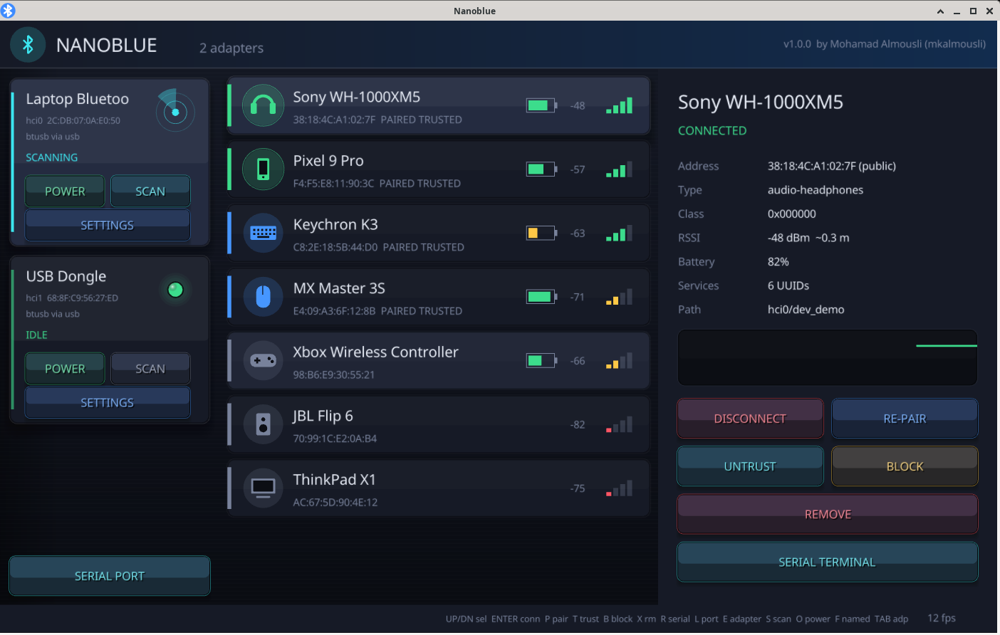
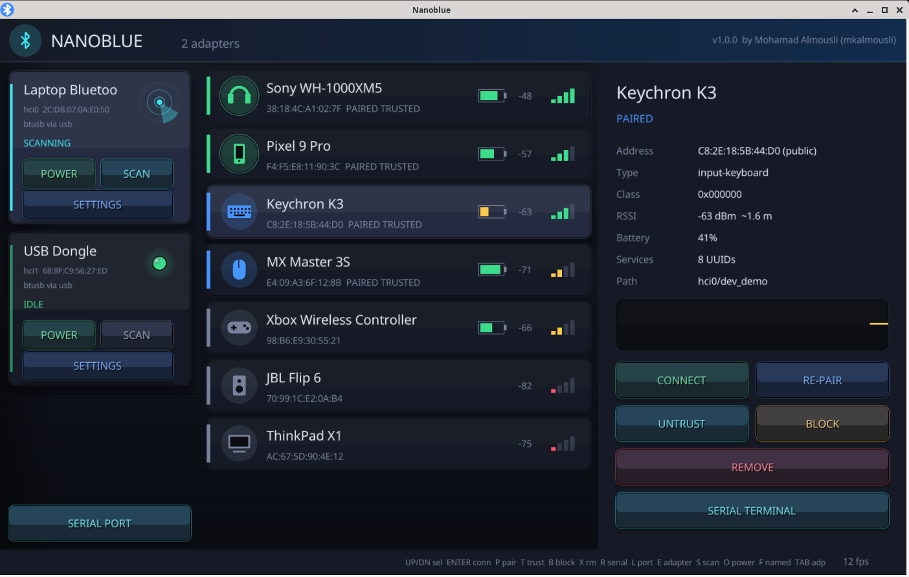
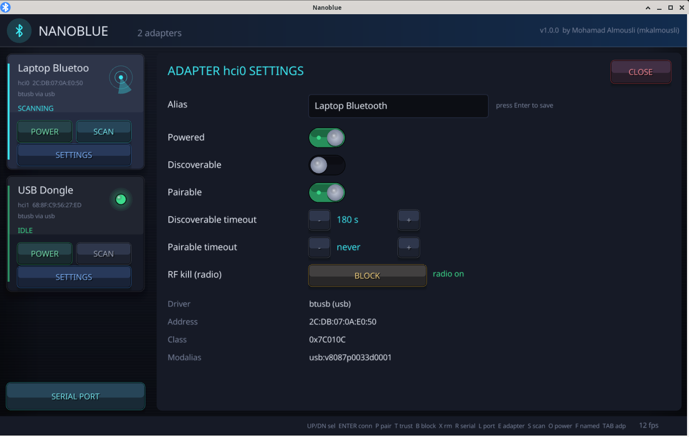

<p align="center"></p>
<h1 align="center">Nanoblue</h1>
<p align="center">A fast, good-looking Bluetooth manager and serial terminal for Linux.<br>
Pure C · raylib · BlueZ over D-Bus · every source file ≤ 100 lines</p>



## Install

```sh
curl -fsSL https://raw.githubusercontent.com/mkalmousli/nanoblue/main/scripts/install.sh | sh
```

Uninstall:

```sh
curl -fsSL https://raw.githubusercontent.com/mkalmousli/nanoblue/main/scripts/uninstall.sh | sh   # or: nanoblue --uninstall
```

Installs to `~/.local/bin/nanoblue` plus a menu entry and icon, no root needed.
Prebuilt binaries (x86_64, aarch64, armv7, i386, riscv64) are on the [releases page](../../releases).
Runtime libraries: `libdbus-1`, `libGL`, `libX11`, and BlueZ running (`bluetoothd`).

## Features

- Realtime device list from BlueZ signals: connect, pair, trust, block, remove, RSSI bars and graph, battery
- Multiple adapters (hci0, hci1, ...) side by side, with scan and power per adapter
- Adapter settings (`E`): alias, powered, discoverable, pairable, timeouts, rfkill block, driver info
- Serial terminal over Bluetooth RFCOMM or a local tty (`/dev/ttyUSB*`, `ttyACM*`), hex/text view, baud and EOL control
- System tray icon (StatusNotifierItem) with menu; closing the window hides to the tray when a tray host exists
- Auto update from GitHub releases (`NANOBLUE_NO_UPDATE=1` to disable, `nanoblue --update` to update now)
- `nanoblue --demo` shows fake devices, no Bluetooth needed. `Ctrl +` / `Ctrl -` scales the UI.

| Device | Adapter settings |
|---|---|
|  |  |

## Keys

`↑/↓` select · `Enter` connect · `P` pair · `T` trust · `B` block · `X` remove · `R` serial over RFCOMM · `L` local port · `E` adapter settings · `S` scan · `O` power · `F` hide unnamed · `Tab` next adapter · `Q` quit

## Build from source

```sh
git clone https://github.com/mkalmousli/nanoblue && cd nanoblue
# needs: cc, git, pkg-config, libdbus-1-dev, libgl1-mesa-dev, libx11-dev (+ libxrandr/xinerama/xcursor/xi-dev for raylib)
cc build.c -o build && ./build          # clones and builds raylib 5.5 on first run, output: bin/nanoblue
./build install                         # optional: ~/.local install
```

Linux only: BlueZ and D-Bus have no equivalent on macOS or Windows.

## License

MIT, see [LICENSE](LICENSE). [@mkalmousli](https://github.com/mkalmousli) · [Source code](https://github.com/mkalmousli/nanoblue)
